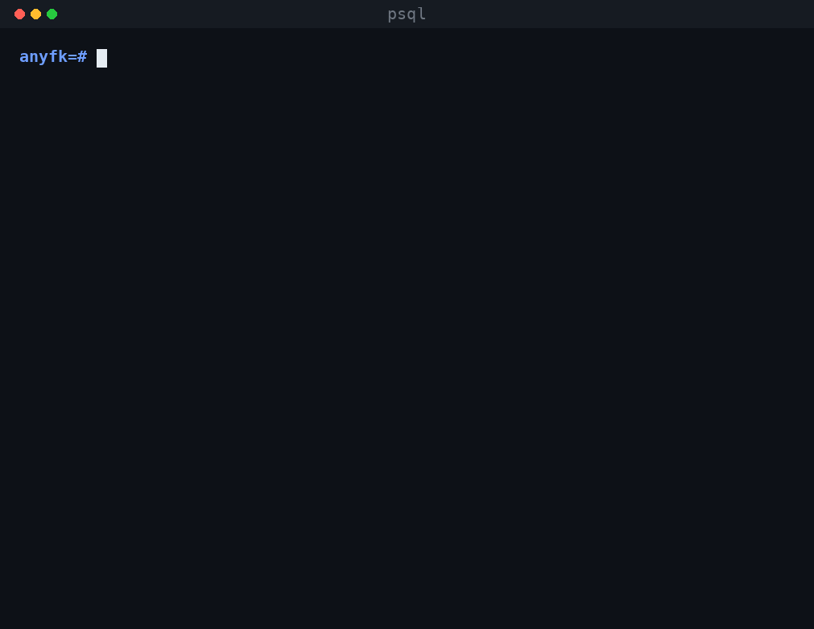

# pg_anyfk

Foreign keys for the elements of an array column.



A `FOREIGN KEY` constrains a whole column, never the values inside an array. So
`tag_ids bigint[]` is a list of numbers that nothing checks: you can store a tag id
that does not exist, and deleting a tag leaves every array still holding it. Postgres
has no syntax for this.

```sql
CREATE TABLE tags  (id bigint PRIMARY KEY);
CREATE TABLE posts (id bigserial PRIMARY KEY, tag_ids bigint[] NOT NULL DEFAULT '{}');
CREATE INDEX ON posts USING gin (tag_ids);

SELECT anyfk.add('posts(tag_ids)', 'tags(id)');
```

That is the whole setup. From there a missing element is rejected on write, and a
referenced tag cannot be deleted, have its key updated, or be truncated away.

## Why not a junction table?

Usually you should use one. This is not for new schemas, it is for the ones that already have array columns, often for sound reasons: the list is short, it is read on the hot path, and the join is not worth it. 

## Install

Postgres 15, 16, 17 or 18. Rust 1.85+ and pgrx 0.19.3 to build.

```sh
cargo install --locked cargo-pgrx@0.19.3
cargo pgrx init --pg18 download
cd pg_anyfk/ext && cargo pgrx install --release
```

```sql
CREATE EXTENSION pg_anyfk;
```

No `shared_preload_libraries` and no restart, so it works on managed Postgres.

## API

| | |
|---|---|
| `anyfk.add(child, parent, is_deferrable, validate, conname)` | Add a constraint. Returns its name. |
| `anyfk.violations(child, parent)` | Elements with no matching parent row, worst first. Reads only. |
| `anyfk.drop_constraint(conname)` | Remove a constraint and its triggers. |
| `anyfk.constraints` | What is registered. |

Both sides are written like a foreign key: `'posts(tag_ids)'`, `'public.tags(id)'`.

`add` checks the existing rows and refuses if any already violate the constraint. Pass
`validate => false` to adopt the data as it is, or look first:

```sql
SELECT * FROM anyfk.violations('posts(tag_ids)', 'tags(id)');
--  missing_element | child_rows
-- -----------------+------------
--  42              |          2
```

`is_deferrable => true` moves the check to commit time, so parent and child rows can be
inserted in any order within one transaction. `conname` overrides the generated name
`<table>_<column>_anyfk`, which is what appears in error messages.

## What it enforces

| Operation | |
|---|---|
| `INSERT` or `UPDATE` with an element that has no parent row | rejected |
| `DELETE` of a referenced parent row | rejected |
| `UPDATE` of a referenced key | rejected |
| `TRUNCATE` of the parent while any array is non-empty | rejected |

Refusing the delete is the only behaviour implemented. The `on_delete` parameter is
reserved for alternatives, the obvious one being to remove the deleted key from each
array rather than refuse.

`NULL` arrays, empty arrays and `NULL` elements pass, matching `MATCH SIMPLE` on a
native foreign key. Duplicate elements are fine. `TRUNCATE parent, child` together is
allowed, as it is for a native foreign key.

Renaming a table or a column, and moving a table to another schema, are all handled.
Tables are stored as a `regclass` so they follow the OID, and an event trigger keeps
the stored column names in step with a rename.

Dropping either table, or the column with `CASCADE`, removes the constraint. A plain
`DROP COLUMN` is refused, because the constraint depends on the column.

## Requirements

- The referencing column must be an array, and its element type must equal the
  referenced column's type, as in `bigint[]` to `bigint`.
- The referenced column needs a single-column unique index, the same requirement a
  native foreign key has.
- You must own both tables, since a trigger is created on each.
- A GIN index on the array column, or every parent `DELETE` scans the child table.
  `add` warns when one is missing.

## Correctness

A trigger that only checks `NOT EXISTS (... WHERE id = ANY($1))` has a race: one
transaction inserts a reference to tag 5 while another deletes tag 5, both commit, and
you are left with a dangling reference and no error on either side.

`anyfk.check_child()` takes a `FOR KEY SHARE` lock on the referenced rows before
checking them, which is what a native foreign key does. `scripts/race_test.sh` proves
it with two live sessions, in both directions.

It is triggers rather than a real constraint, so nothing appears in `\d` or
`pg_constraint`, and `ALTER TABLE ... DISABLE TRIGGER` switches it off.

## Development

```sh
cargo fmt --all --check
cargo clippy --workspace --all-targets -- -D warnings
cargo test -p pg_anyfk_core   # parsing tests 
./scripts/race_test.sh 18        

cd ext
cargo pgrx test pg18             # in-Postgres tests; also pg15, pg16, pg17
cargo pgrx run pg18              # psql against a scratch instance
```

`cargo pgrx run` reuses its database and will not re-run `CREATE EXTENSION`, so after
changing `ext/sql/`: `DROP EXTENSION pg_anyfk CASCADE; CREATE EXTENSION pg_anyfk;`

`scripts/make_demo.py` regenerates the GIF at the top of this file.

